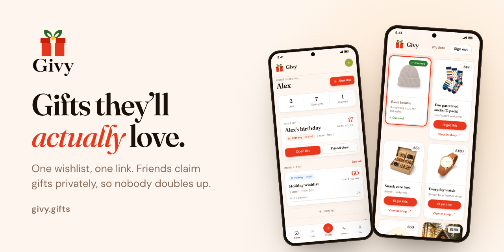
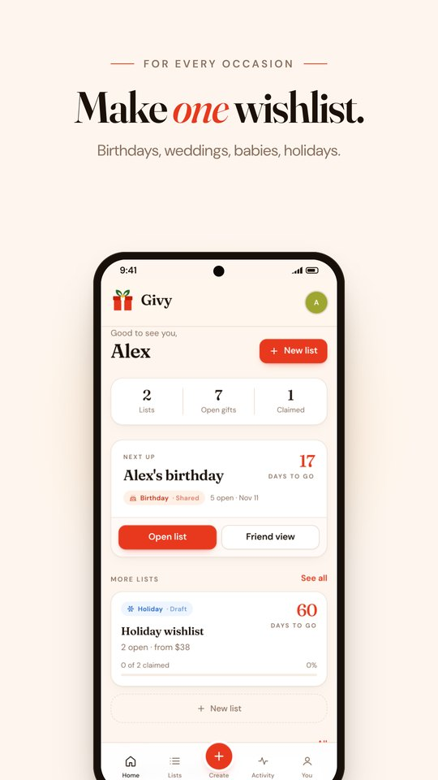
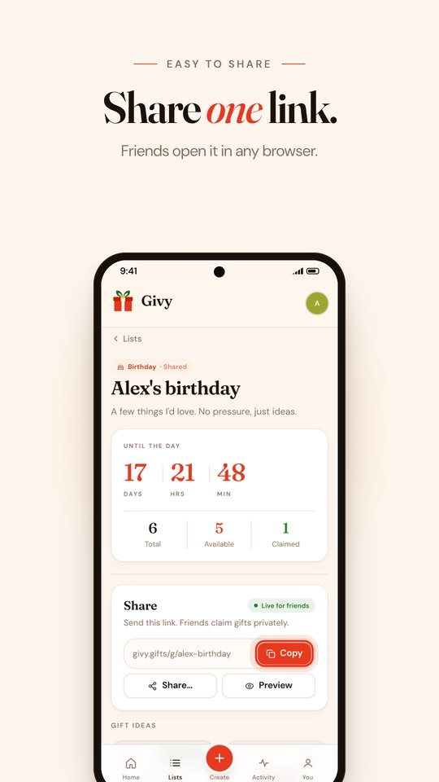
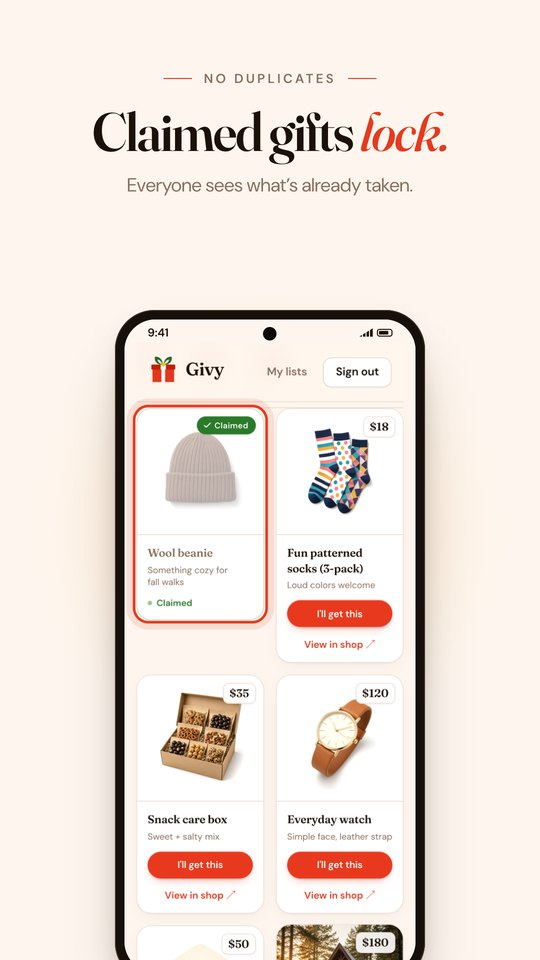
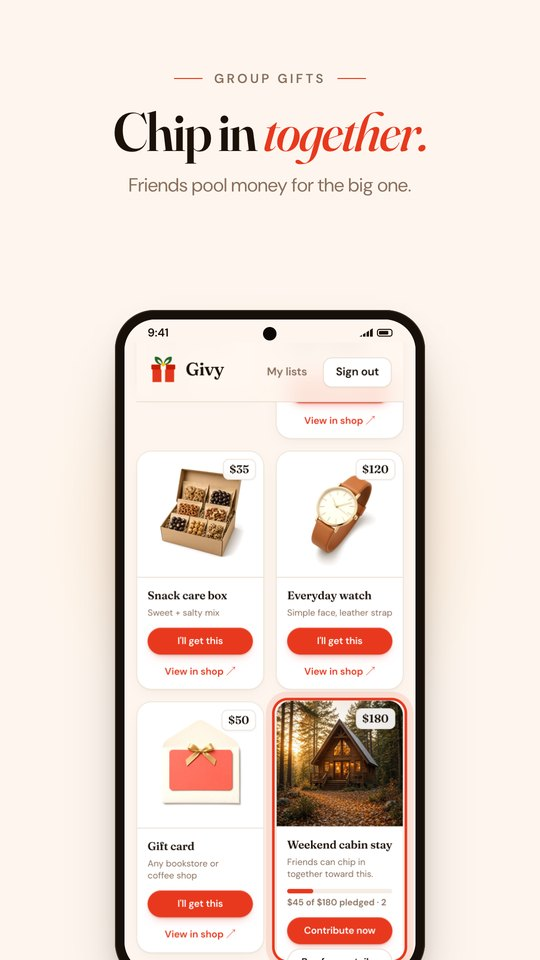

<p align="center">
  <a href="https://www.givy.gifts"></a>
</p>

<p align="center">
  <a href="https://www.givy.gifts"><b>www.givy.gifts</b></a>
  &nbsp;·&nbsp;
  <a href="https://play.google.com/store/apps/details?id=com.givy.givy">Google Play</a>
  &nbsp;·&nbsp;
  <a href="mailto:hello@givy.gifts">hello@givy.gifts</a>
</p>

Givy is a gift wishlist you share with one link. Friends open it in any browser, claim a gift, and everyone else sees it's taken. You never see who claimed what, so the surprise stays a surprise.

<table>
  <tr>
    <td align="center" width="25%"></td>
    <td align="center" width="25%"></td>
    <td align="center" width="25%"></td>
    <td align="center" width="25%"></td>
  </tr>
</table>

## What it does

- **One list per occasion.** Birthdays, weddings, baby showers, holidays, graduations.
- **Works with any shop.** Paste a product link and Givy pulls the photo and title.
- **No duplicates.** A claimed gift locks for everyone else on the list.
- **Claims stay secret.** Owners see what's taken, never who took it.
- **Group gifts.** Friends can pledge toward a bigger item together.
- **Private address.** A ship-to address is shown only to the person who claims a gift.
- **Gift ideas.** AI suggestions by occasion and budget, with a curated offline fallback.
- **Sign in your way.** Email, Google, or Facebook, with an optional closed-beta invite gate.

## Stack

| Layer | Tech |
|-------|------|
| Web | Next.js 15 (App Router), React 19, Tailwind CSS 4 |
| UI | Fraunces and DM Sans, Lucide icons, Radix dialogs, Framer Motion |
| Cloud | Supabase Auth, Postgres, row-level security |
| Local demo | Browser storage and demo sign-in, no backend needed |
| Android | Flutter shell in `mobile/` that loads the live site |
| Hosting | [Render](render.yaml), auto-deploys `master` |

## Run it locally

```bash
git clone https://github.com/WejdanBa-CS/Givy.git
cd Givy
npm install
cp .env.example .env.local   # leave blank for local demo mode
npm run dev
```

Open [localhost:3000](http://localhost:3000), sign in, create a list, then finalize and share it.

## Environment

Copy `.env.example` to `.env.local`. The minimum for cloud mode:

```env
NEXT_PUBLIC_SUPABASE_URL=https://YOUR_PROJECT.supabase.co
NEXT_PUBLIC_SUPABASE_ANON_KEY=your-anon-key
NEXT_PUBLIC_SITE_URL=http://localhost:3000
```

Optional: `OPENAI_API_KEY` for gift ideas, `NEXT_PUBLIC_BETA_REQUIRE_INVITE=true` for a closed beta.

Never commit `.env.local` or secrets. The Supabase service role key is not used by this app and must stay out of it.

## Supabase setup

1. Create a project at [supabase.com](https://supabase.com).
2. Run every file in `supabase/migrations/` in the SQL editor, in numeric order (`001` through `014`).
3. Enable Google, and optionally Facebook, under Authentication > Providers.
4. Set the Site URL to `https://www.givy.gifts` and add `https://www.givy.gifts/auth/callback` to the redirect URLs.
5. Create invite codes in SQL as described in [`BETA.md`](BETA.md). Don't reuse demo seeds in production.

## Deploy

Connect the repo to Render as a Blueprint using [`render.yaml`](render.yaml). It defines two services:

- `givy` deploys `master` to production.
- `givy-staging` deploys the `staging` branch with its own Supabase project.

Supabase URL and anon key must be set at build time.

The Google Play build steps are in [`mobile/docs/RELEASE_PLAY.md`](mobile/docs/RELEASE_PLAY.md).

### Affiliate links (off by default)

Don't enable Skimlinks until `www.givy.gifts` is approved in your publisher account. An unapproved ID turns shop links into broken redirects.

1. Get the site approved in [Skimlinks](https://skimlinks.com).
2. On Render, set both `NEXT_PUBLIC_SKIMLINKS_PUBLISHER_ID` and `NEXT_PUBLIC_SKIMLINKS_ENABLED=true`.
3. Redeploy and check that "View product" opens the retailer.

## Scripts

| Command | What it does |
|---------|-------------|
| `npm run dev` | Dev server with Turbopack |
| `npm run build` | Production build |
| `npm run start` | Serve the production build |
| `npm run lint` | ESLint |
| `npm test` | Vitest unit tests |
| `npm run test:e2e:security` | Playwright security smoke tests |

## Project layout

```
src/app/          Routes: landing, /app, /g/[code], API
src/components/   UI and panels
src/lib/          API, security, local store, Supabase client
supabase/         SQL migrations
e2e/              Playwright tests
mobile/           Flutter Google Play shell
```

## License

Copyright © 2026 Wejdan Al Amri. All rights reserved.

The source is published for transparency and portfolio use. See [`LICENSE`](LICENSE). You may not copy, redistribute, or run a competing service from this code without permission.

Please report security issues privately as described in [`SECURITY.md`](SECURITY.md).
